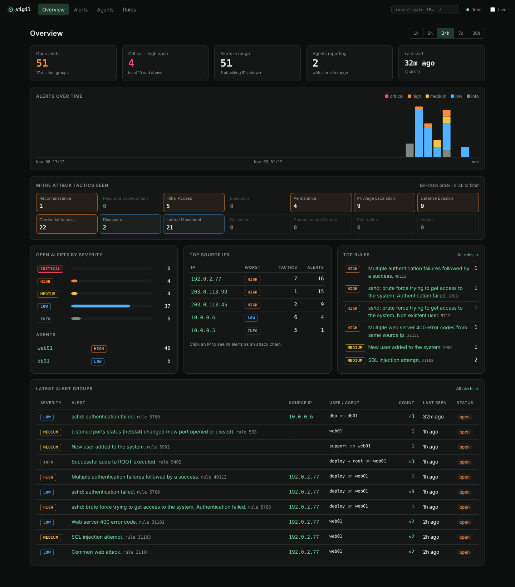

# Vigil

A Wazuh SIEM homelab: the deployment, a triage dashboard for its alerts,
and (next) custom detection rules.

[Trellis](https://github.com/Garrickkk/trellis-miniSIEM) is the SIEM I wrote
from scratch to learn how they work. Vigil is the next step: a real SIEM
(Wazuh 4.14) deployed with Docker, fed by agents on lab VMs, and attacked
the same way Trellis was, so the two can be compared on identical attacks.

The dashboard reads alerts straight from the Wazuh indexer and is built for
the part Wazuh's own UI makes slow: deciding what matters.



## What's in here

- **`setup/vigil.ps1`**: one command to run Wazuh on Windows with Docker
  Desktop. It pins the version, generates TLS certificates, fixes the
  `vm.max_map_count` setting inside Docker Desktop's VM, and binds the
  dashboard, indexer and API to **localhost only** (upstream exposes them
  all on your network, with default passwords).
- **`agent/install-agent.sh`**: enrolls an Ubuntu/Debian VM as a Wazuh agent
  and adds the nginx access log, the same log sources Trellis reads.
- **The Vigil dashboard** (`python -m vigil serve`), a Flask app in the same
  style as Trellis's, with:
  - **Grouped alerts.** Wazuh raises one alert per log line, so a brute force
    is 9 alerts. Vigil groups them by rule + source IP + agent: one row,
    `×9`, triaged in one click.
  - **Attack chains.** Click any IP to see its alerts in time order, mapped
    onto the MITRE ATT&CK kill chain, with an **"after the login"** section
    showing what happened on the host after that IP got in. Wazuh can't link
    `sudo` or `useradd` alerts to the attacker (they carry no source IP);
    Vigil shows them by time so you can.
  - **Triage that Wazuh doesn't have**: open / acknowledged / closed plus a
    note on every alert, kept in a local SQLite file.
  - **Counted by the indexer.** Summary pages use OpenSearch aggregations, so
    a Nikto scan of thousands of requests is one small query, not thousands of
    downloaded alerts (the first version capped at 5,000 and could overload
    the indexer on a 16 GB laptop).
  - **Honest kill chains.** Wazuh tags its web-attack rules with tactics like
    Privilege Escalation, so a scan of 404s "reached" Lateral Movement.
    Requests the server rejected are marked as attempts and count only as
    Reconnaissance.
  - **Real event times.** After an outage the agent replays buffered events,
    which Wazuh timestamps on arrival. Vigil reads the original time from the
    log line and flags delayed events.
  - ATT&CK tactic overview, severity timeline, per-agent and per-rule views,
    CSV export, and a demo mode that works without Wazuh.
- **`rules/`**: custom Wazuh rules and decoders (with logtest test cases) that close the gaps
  the [comparison](docs/comparison.md) finds in Wazuh's default ruleset,
  each with test logs.
- **`docs/`**: lab setup, the attack scenarios, and a
  [Trellis vs Wazuh comparison](docs/comparison.md).

## Quick start: try the dashboard

No Wazuh needed. Requires Python 3.10+.

```bash
pip install -r requirements.txt
python -m vigil serve --demo     # open http://127.0.0.1:5050
```

The demo plays the same attack as Trellis's samples, as the alerts Wazuh's
default ruleset raises for it: a web scan, an SSH password spray, then one
attacker who probes the site, brute-forces SSH, gets in, opens a root shell,
adds a backdoor account and opens a listening port.

## Running the real thing

Full walkthrough: **[docs/lab-setup.md](docs/lab-setup.md)**. In short:

```powershell
# 1. Wazuh (Windows, Docker Desktop running). First run takes 5-10 minutes.
.\setup\vigil.ps1 up
# Wazuh's own dashboard: https://localhost   (admin / SecretPassword)
```

```bash
# 2. On each lab VM (Ubuntu), point an agent at your PC
sudo ./agent/install-agent.sh 192.168.56.1 web01
```

```powershell
# 3. The Vigil dashboard against the live indexer
copy .env.example .env           # then set VIGIL_INDEXER_PASSWORD
python -m vigil check            # ok: indexer green
python -m vigil serve            # http://127.0.0.1:5050
```

Then run the attacks in [docs/attack-scenarios.md](docs/attack-scenarios.md)
from a Kali VM and watch them land.

```powershell
.\setup\vigil.ps1 status   # containers + health checks
.\setup\vigil.ps1 logs     # follow the Wazuh manager log
.\setup\vigil.ps1 down     # stop (keeps data)
.\setup\vigil.ps1 reset    # delete everything and start over
```

## How it fits together

```
lab VMs (agents) ──1514/1515──▶ Wazuh manager ──▶ Wazuh indexer ◀── vigil dashboard
  auth.log, nginx,              decoders + rules     (OpenSearch,        (Flask, reads
  netstat, FIM                  → alerts             localhost:9200)      alerts over HTTPS)
```

Vigil never writes to Wazuh. It queries the `wazuh-alerts-*` indices and
keeps its own triage state in `vigil-triage.db`.

## Security notes

The lab is for attacking yourself, so the setup tries hard not to expose you
to anyone else:

- Only the agent ports (1514/1515) listen beyond localhost. The Wazuh
  dashboard, the indexer and the API are bound to `127.0.0.1`.
- Vigil verifies the indexer's TLS certificate against wazuh-docker's own CA
  and checks it was issued to `wazuh.indexer`. It doesn't just turn
  verification off. (Python 3.13+ is stricter than Wazuh's self-made CA
  allows; Vigil relaxes only that one check. See `sources.py`.)
- The dashboard has no login, so it listens on localhost only and rejects
  cross-site form posts. It sends a strict Content-Security-Policy (no inline
  scripts), and escapes all log text, because attackers control what ends up
  in logs. CSV export defuses spreadsheet formulas for the same reason.
- `SecretPassword` is Wazuh's public default. Change it before the lab is
  reachable from anywhere but your own PC ([lab setup](docs/lab-setup.md#passwords)).

## Tests

```bash
pip install pytest
pytest
```

## Related

- [grapevine-scanner](https://github.com/Garrickkk/grapevine-scanner): the network scanner
- [trellis-miniSIEM](https://github.com/Garrickkk/trellis-miniSIEM): the from-scratch SIEM
